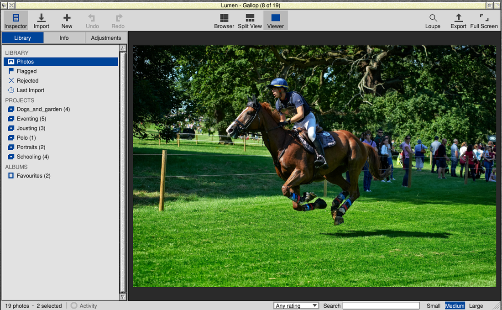
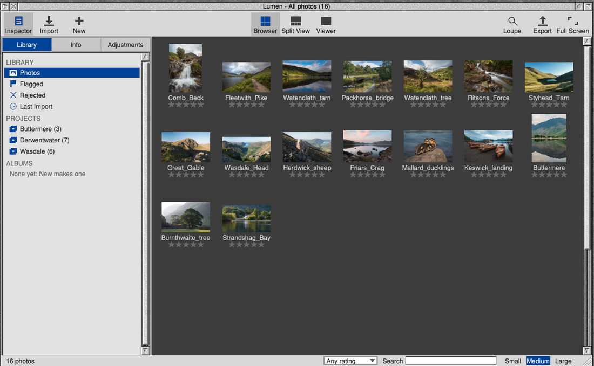
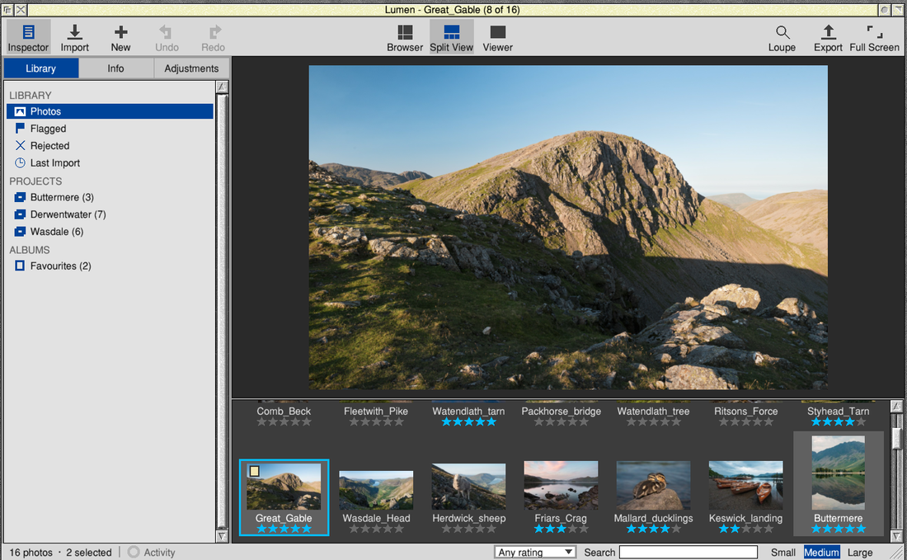
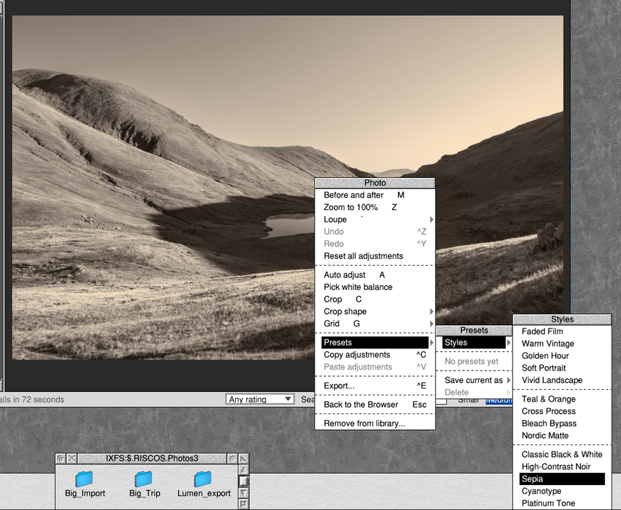
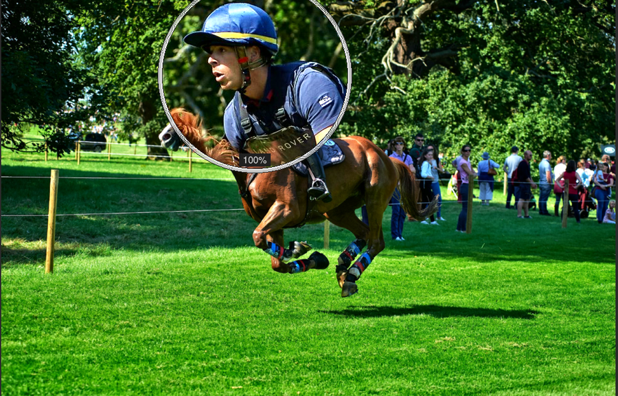

# Lumen

A photo library and non-destructive editor for RISC OS 5: one window with
a browser, a viewer, a split view and full screen, and an inspector beside
them.



Lumen keeps your photos in one library (projects, albums, smart albums and
stacks), helps you sort them (stars, flags, labels, captions, keywords,
search) and improves them without ever changing their files: white
balance, exposure, highlights and shadows, levels, curves, contrast,
saturation, colour by hue, split toning, noise reduction, sharpening,
vignette, glow, straightening, perspective and cropping, retouching and
brushes, or one of fifteen styles. Then it exports or prints them.

- **Download:** the latest release is on the
  [releases page](https://github.com/adyoull/riscos-lumen/releases).
- **User guide:** inside the zip as `!Lumen.Guide`, and on Lumen's icon bar
  menu.
- **Camera raw files:** with the LumenRaw plug-in (LibRaw), a separate zip
  on the same page.
- **HEIF and AVIF photos** (.heic, as phones take them, and .avif): with
  the LumenHEIF plug-in (libheif, FFmpeg's HEVC decoder and dav1d), also
  on that page.

I've used AI to help with this. The code, build scripts and documentation
were written with Anthropic's Claude as a coding assistant.

## What you need

- RISC OS 5.30 or later. Built for the Raspberry Pi 4, 400 and CM4; other
  ARMv7 machines with VFPv3 should work. NEON is used when the processor
  has it, with plain code (giving the same pictures) when it hasn't.
- SharedUnixLibrary 1.16 or later and ARMEABISupport, from PackMan.

## Installing

1. Install SharedUnixLibrary and ARMEABISupport with PackMan, if you
   haven't already.
2. Unzip `Lumen-0.0.37.zip` and copy `!Lumen` to where you keep your
   applications, for example `$.Apps.Graphics`.
3. For camera raw files, unzip `LumenRaw-1.1.zip`: it holds
   `!Lumen.Plugins.LibRaw`. Drag that `LibRaw` directory into Lumen's
   Plug-ins > Add plug-in window, or copy it into your
   `!Lumen.Plugins`.
4. For HEIF and AVIF photos, likewise unzip `LumenHEIF-1.1.zip` and add its
   `!Lumen.Plugins.HEIF` directory.
5. Double-click `!Lumen`, and drag a folder of photos into its window.

## What it does

- Imports JPEG and PNG photos (raw files with LumenRaw, HEIF and AVIF
  photos with LumenHEIF), in the
  background, never copying or changing them; finds them again if they
  move; watches folders for new photos.
- Browses thumbnails in three sizes; a viewer with a 100% view and a
  round loupe; split view and full screen.
- Stars, flags, rejects, colour labels, captions and keywords; search,
  a rating filter and smart albums; versions and stacks.
- Adjustments in 16-bit linear light, with undo, before and after, Auto,
  presets, styles shown on the photo as you move down the list, and
  copying adjustments between photos.
- Exports JPEG or PNG at any size, in sRGB, Adobe RGB or Display P3,
  sharpened for the size, with EXIF, caption and keywords; prints to any
  RISC OS printer.
- Exports, imports and checks (and repairs) whole libraries.
- Keeps a working-size preview of each raw photo so it opens at once.
- Interactive help (!Help), Choices, an Activity window, and
  `!Lumen.Bench` to time it on your machine.

| | |
|---|---|
|  |  |
|  |  |

The photos in the screenshots and the guide are Andrew Youll's own
(copyright Andrew Youll).

## Layout

```
src/core/   portable C: catalogue (SQLite), EXIF, thumbnails, importer,
            recipe.c (adjustments as text), develop.c (the pipeline),
            geometry.c (turn, straighten, perspective, crop), autoadj.c
  fsys_riscos.c / fsys_posix.c   the filing system, RISC OS or Linux
  sqlite_vfs.c                   SQLite on plain POSIX calls, native paths
src/ui/     the Wimp front end: app, browser window, viewer, menus, looks
            (copy/paste and presets), sprites
tests/      test_core and test_develop (Linux and ARM/QEMU), test_ui and test_fsys
            (Fake RISC OS), bench.c (LumenBench), shots/ (make shots)
app/        !Run, !Boot, !Help, icons (make-icons.py draws them)
third_party/sqlite/   SQLite 3.49.2 amalgamation
```

Library on disc: `<Lumen$Library>` (default `<Choices$Write>.Lumen.Library`)
holds `Catalogue` (SQLite), `Thumbs` (256 subdirectories of JPEGs) and
`Previews` (working-size copies, the same way);
an exported or imported library may also have `Originals`, and a repaired
one `Catalogue-backup`.

## Building

Needs [riscos-crossdev](https://github.com/adyoull/riscos-crossdev) 1.8.2 (`make prebuilt devkit`) and libjpeg-turbo
3.0.4 and libpng 1.6.44 built for four targets (`deps/build-deps.sh`):
RISC OS, x86-64, ARM Linux and 32-bit x86 (for the Fake RISC OS tests).

```
make RCD_DIR=/path/to/riscos-crossdev DEPS=/path/to/deps check all
```

`make check` runs test_core on x86-64 (with ASan/UBSan) and on ARM under
qemu-arm-aligntrap, test_ui and test_fsys against the Fake RISC OS, and
riscos-crossdev's checks on the RISC OS binary. `make` builds
`out/Lumen.zip`; `make plugin` the LumenRaw plug-in and LibRaw's source
zip (LibRaw built by `deps/build-libraw.sh`); `make heif-plugin` the
LumenHEIF plug-in and its sources zip (FFmpeg, dav1d and libheif built by
`deps/build-heif.sh`, `make test-heif` testing it on x86-64 and on ARM
with and without NEON); `make guide` the two user guides as zips.

## Status

0.0.36 was the first public release. 0.0.37 adds format plug-ins (the
first is LumenHEIF, for HEIF and AVIF photos) and simpler menus. Lumen has
been tested on RISC OS 5.31 on a Raspberry Pi 4, and on RISC OS running on
Linux (RISC OS 5.31-5 under QEMU); its automated tests run on Linux
(x86-64, and ARM under QEMU with and without NEON).

## Plug-ins

Lumen reads JPEG and PNG itself. Other formats come from plug-ins in
`!Lumen.Plugins`: LumenRaw for camera raw files, and format plug-ins
such as LumenHEIF, whose `Plugin` file says which files they read. The
format plug-in API is in [docs/plugin-api.md](docs/plugin-api.md).

## Licence

Lumen is copyright (c) 2026 Andrew Youll and is released under the MIT
licence: see `LICENSE`. The LumenRaw plug-in's own code is MIT too; the
LibRaw library it is built with is under the LGPL 2.1 (or CDDL), and its
source ships with each release (`LibRaw-0.22.3-source.zip`). The
LumenHEIF plug-in's own code is MIT; libheif is under the LGPL 3 and
FFmpeg's libavcodec and libavutil under the LGPL 2.1 or later, dav1d
under its BSD licence, and their sources and the patches ship as `LumenHEIF-1.1-sources.zip`. The
libraries built into Lumen keep their own licences, collected in
`app/Licences` (installed as `!Lumen.Licences`): SQLite (public domain),
libjpeg-turbo, libpng, zlib and UnixLib (BSD-style, with LGPL parts:
Lumen's source is published so it can be relinked).
